# PayFlow

[](https://github.com/ojxsmali/payflow/actions/workflows/ci.yml)
[](https://payflow-xi-one.vercel.app)
[](LICENSE)

**Create invoices. Track payments. Know what's outstanding.**

PayFlow is an invoicing and payment-tracking app for freelancers and independent professionals. It follows one lifecycle — *draft → send → get paid* — and every screen exists to move an invoice along it or to show where the money stands.

**Live:** https://payflow-xi-one.vercel.app — sign up, then use *Load sample data* on the overview to explore a fictional workspace.

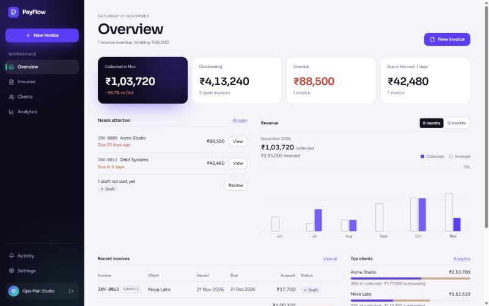

## Screenshots

**Public landing page** — what a signed-out visitor sees: an example invoice that walks the real lifecycle (Draft → Sent → Viewed → Partially paid → Paid) with totals from the app's own invoice maths, slow "payment flow" lines behind the hero, and a tabbed gallery of real screens.

| | |
|---|---|
| 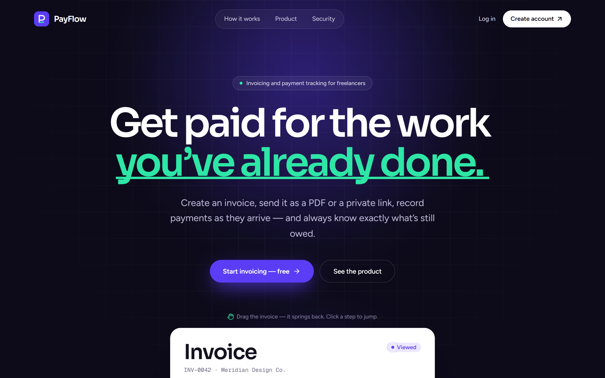 | 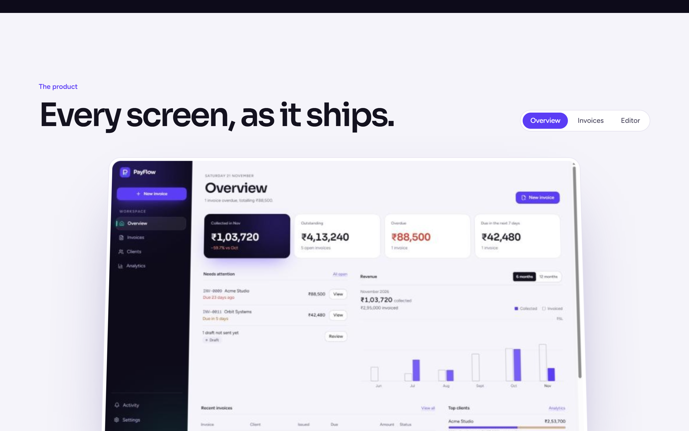 |

<p align="center">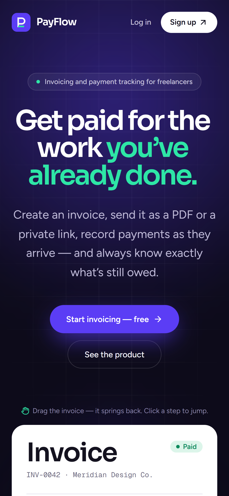</p>

**Inside the app**

| | |
|---|---|
| 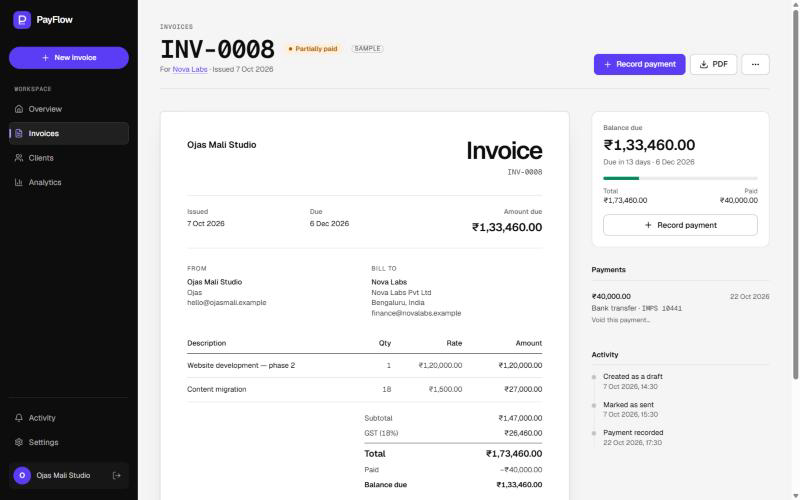 | 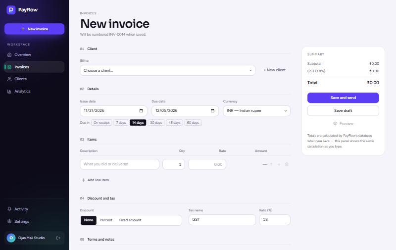 |
| **Invoice** — the document, balance due, payments (voided ones kept) and a full activity log | **Editor** — line items, discount and tax, live totals the database recomputes on save |
| 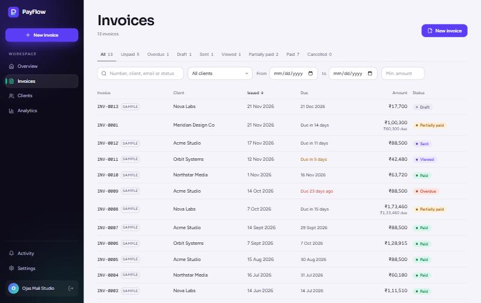 | 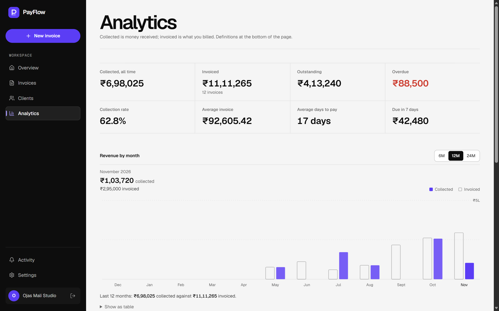 |
| **Invoices** — status tabs, search, client/date/amount filters, sortable columns | **Analytics** — every metric has a written definition on the page |
| 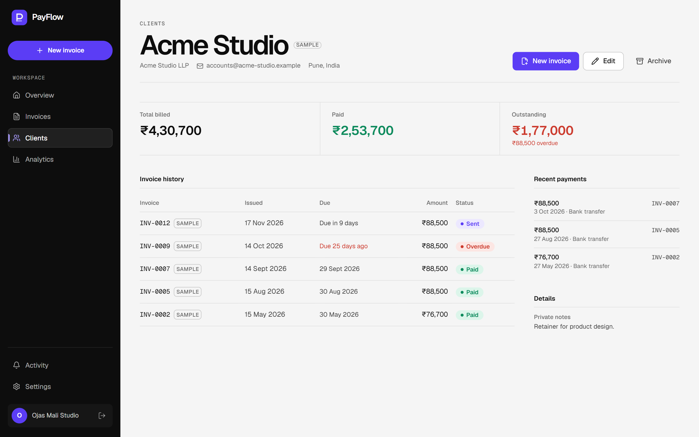 | 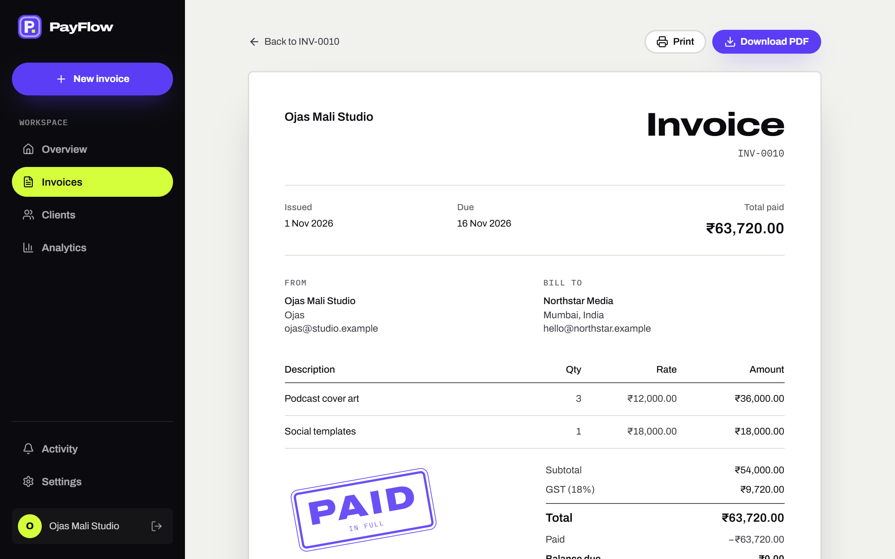 |
| **Client** — billed / paid / outstanding, invoice and payment history | **Client view** — what the client sees at `/i/:token`, no account needed |

<p align="center">
  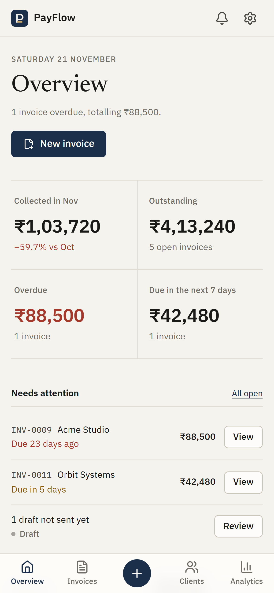
  &nbsp;
  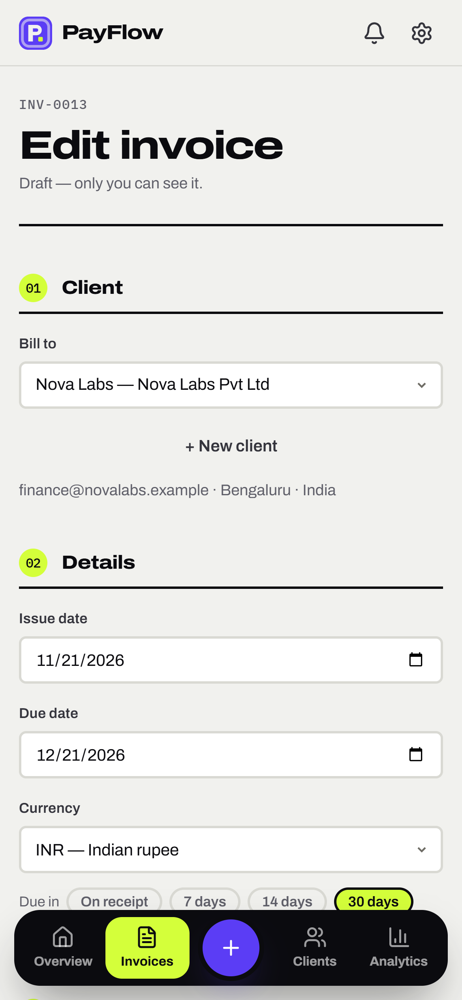
  &nbsp;
  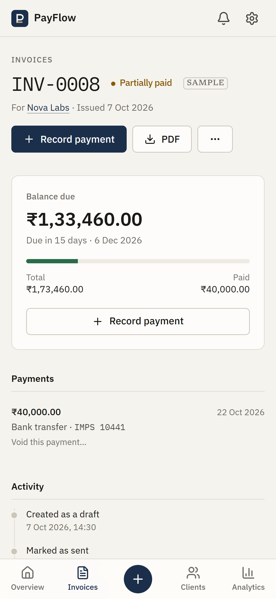
</p>

*Overview, Invoices and Editor show the current violet design. The invoice, client, analytics and phone screenshots were taken before the November 2026 restyle, so they still show the earlier navy colour scheme; the layouts and features are unchanged.*
<p align="center"><sub>Designed for phones too: bottom navigation, stacked line items, bottom-sheet dialogs.</sub></p>

<sub>Screenshots use the built-in sample workspace; the businesses in it are fictional.</sub>

---

## Features

- **Real accounts** — Supabase Auth (email + password, password reset, persistent sessions). Every row is protected by Postgres Row Level Security.
- **Clients** — create, edit, search, sort, archive (clients with invoices are never hard-deleted). Each client page shows billed / paid / outstanding and the full invoice and payment history.
- **Invoice editor** — client, dates with due-date presets, dynamic line items (add, remove, reorder; stacked layout on phones), percent or fixed discount, configurable tax name and rate, payment terms, notes, live totals and a client-view preview.
- **Server-side money** — the database assigns invoice numbers and computes every total; the browser's live total is a mirror that is tested to match it exactly.
- **Status workflow** — Draft → Sent → Viewed → Partially paid → Paid, with Overdue and Cancelled. Payment progress and lateness are *derived*, never typed in.
- **Payments** — record full or partial payments (bank transfer, UPI, cash, card, PayPal, cheque, other) with reference and notes. Payments are immutable; mistakes are *voided with a reason* and stay in the history.
- **PDF** — real, text-based A4 PDFs (selectable text, embedded fonts, ₹ glyphs) generated with `@react-pdf/renderer`. Rows never split across pages; tested at 1, 5 and 24 items with long descriptions.
- **Sending** — email through Resend with the PDF attached, *only* when the deployment has it configured (the live demo uses Resend's test sender, so it can only deliver to the owner's address). Otherwise the app says so and offers copy-link, open-in-mail-app, or "I sent it myself".
- **Client link** — `/i/:token` shows a sent invoice to the client without an account and records the first view.
- **Dashboard** — collected this month (with a real month-over-month change), outstanding, overdue, due in 7 days — each opens the matching invoices — plus "Needs attention", a 6/12-month revenue chart, recent invoices and top clients.
- **Analytics** — collection rate, average invoice, average days to pay, revenue by month and by client, invoices by status, and a written definition of every metric.
- **Activity** — per-invoice timeline (created, sent, viewed, edited, payments, voids, cancelled) and an account-wide activity feed.
- **Settings** — business profile, logo upload (validated and re-encoded in the browser), invoice defaults (currency, tax, terms, notes, prefix, next number), payment instructions, time zone, email copy, sample data.
- **Onboarding** — three skippable steps after sign-up; a useful first-run screen instead of an empty dashboard; an optional, clearly labelled sample workspace.

## Tech stack

| Layer | Choice | Why |
|---|---|---|
| UI | React 19 + TypeScript, Vite 8 | Fast, typed, route-level code splitting |
| Styling | Tailwind CSS 4 with design tokens in `src/index.css` | One source for colour, type, radius, motion |
| Data | Supabase (Postgres, Auth, Storage) | Real auth + RLS without running a server |
| PDF | `@react-pdf/renderer` | Vector PDF from React components, lazy-loaded |
| Email | Resend, via one Vercel function (`api/send-invoice.ts`) | Key stays server-side |
| Charts | Hand-written SVG | Two series and one axis don't need a chart library |
| Icons | Lucide | Consistent, tree-shaken |
| Tests | Vitest, PGlite (real Postgres in-process) | Unit, PDF and database/RLS tests without Docker |

## Architecture

```
api/send-invoice.ts          Vercel function: auth check → RLS-scoped read → Resend → mark sent
supabase/migrations/         schema, RLS, functions (the business rules live here)
supabase/tests/db-check.mjs  63 database checks: money, lifecycle, isolation, public link
scripts/                     db-push (apply migrations), woff-to-ttf (PDF fonts)
src/
  lib/          money.ts (minor units, BigInt math), analytics.ts, dates.ts, status.ts, errors.ts
  services/     the only place that talks to Supabase (clientService, invoiceService, …)
  hooks/        useLoad (fetch + global invalidate), useBusinessData
  auth/         AuthProvider, session + profile
  components/
    ui/         Button, Field, Input, Select, Segmented, Dialog, Toast, StatusBadge, EmptyState, Skeleton…
    layout/     AppShell (sidebar / bottom nav), ActivityFeed, Logo
    invoices/   InvoiceTable, LineItemsEditor, InvoiceDocument, dialogs, pdf/
    clients/    ClientFormDialog
    charts/     RevenueChart, ClientBars
  pages/        one file per route
```

UI components never query the database; pages call services; money and metric logic lives in `lib/` and is unit-tested.

## Database schema

| Table | Purpose |
|---|---|
| `profiles` | 1:1 with `auth.users`; business details, invoice defaults, invoice counter, time zone |
| `clients` | `user_id` → owner; contact + tax details; `archived_at` |
| `invoices` | `client_id` (FK, restrict), number, dates, currency, discount/tax settings, **computed** subtotal/discount/tax/total/amount_paid, lifecycle `state`, `public_token` |
| `invoice_items` | description, `quantity numeric(12,3)`, `unit_price bigint`, `amount` (generated column) |
| `payments` | amount, date, method, reference, notes, `voided_at` + `void_reason` |
| `invoice_events` | append-only activity log |
| view `invoice_overview` | invoice + client name + `balance_due`, derived `status`, `days_until_due` |

Relationships: user → clients → invoices → items / payments / events. `unique (user_id, invoice_number)`.

## Authentication

Supabase Auth with email + password. Sign-up stores the name in user metadata; a trigger creates the `profiles` row. Sessions persist and refresh in the browser. Password reset sends a link to `/update-password`. Routes are guarded in the client **and** every query is enforced by RLS in the database — route guards are a convenience, not the security boundary.

## Security model

- **RLS on every table.** Users can `select` only rows where `user_id = auth.uid()`.
- **Write paths are narrow.** Users may write `profiles` (specific columns) and `clients` directly. `invoices`, `invoice_items`, `payments` and `invoice_events` are read-only to users; all changes go through `SECURITY DEFINER` functions (`save_invoice`, `record_payment`, `void_payment`, `mark_invoice_sent`, `cancel_invoice`, …) that check `auth.uid()`, validate input, enforce the lifecycle and log an event. A user therefore cannot set a total, a status or someone else's `user_id`.
- **Grants are explicit.** The migration revokes everything from `anon`/`authenticated` and grants back only what is used, so it is safe even on projects that auto-grant new tables.
- **Public invoice links** use a 48-hex-character random token (192 bits), never the invoice id. `get_public_invoice()` returns one sent invoice with no internal ids or account email; drafts are never exposed.
- **Email endpoint** forwards the user's JWT so it reads under RLS (no service-role key anywhere), and only ever sends to the client email stored on the invoice.
- **Logos** live in a public bucket (they're printed on invoices) but each user can only write inside a folder named after their own id; PNG only, 512 KB max.
- Secrets live in environment variables; the browser only gets the public anon key.

`npm run test:db` proves isolation: user A cannot read, update, delete, invoice, pay or send anything belonging to user B, and anonymous users can't query any table.

## Invoice lifecycle

Stored facts (`state`): `draft`, `sent`, `viewed`, `cancelled` — plus payments.
Displayed status is derived in `invoice_overview`, in this precedence:

1. **Cancelled** — state is cancelled
2. **Draft** — never sent
3. **Paid** — payments ≥ total
4. **Overdue** — today (in the user's time zone) is after the due date and a balance remains
5. **Partially paid** — some payment, balance remains, not late
6. **Viewed** — client opened the link
7. **Sent**

Rules enforced by the database: payments only on sent invoices; a payment can't exceed the balance or be future-dated; invoices with payments can't be edited or cancelled (void the payments first); drafts are deleted, sent invoices are cancelled; zero-value invoices can't be sent; the invoice counter can't move backwards. `paid_at` is the date of the payment that cleared the balance, not when it was recorded.

## Financial calculations

All amounts are integers in the currency's minor unit (paise, cents); percentages are integers in basis points (1800 = 18%). No floats touch money.

```
line amount  = round(quantity × unit price)
subtotal     = Σ line amounts
discount     = percent: round(subtotal × rate)   |  fixed: min(value, subtotal)
taxable      = subtotal − discount
tax          = round(taxable × tax rate)
total        = taxable + tax
balance due  = total − Σ non-voided payments
```

Rounding is half-up to the minor unit (Postgres `round(numeric)`). The database function `pf_recompute_invoice` is the source of truth; `src/lib/money.ts` mirrors it with BigInt for the live editor, and `test:db` checks 60 generated invoices produce identical totals in both.

**Metric definitions** (also shown in the app):

| Metric | Definition |
|---|---|
| Collected | Sum of non-voided payments, by payment date |
| Invoiced | Totals of sent, viewed, partially paid, overdue and paid invoices (no drafts, no cancelled) |
| Outstanding | Balance due on sent, viewed, partially paid and overdue invoices |
| Overdue | Outstanding on invoices past their due date |
| Collection rate | Paid ÷ invoiced on issued invoices; "—" when nothing is invoiced |
| Average invoice | Invoiced ÷ number of issued invoices; "—" when none |
| Average days to pay | Issue date → date of the payment that cleared the invoice, averaged |
| Month-over-month | (this month − last month) ÷ last month; hidden when last month is zero |

Currencies are never mixed or converted: metrics are per currency (INR, USD, EUR, GBP supported; adding one is a constant in `money.ts` plus the DB check constraint).

## PDF generation

`src/components/invoices/pdf/` renders the invoice with `@react-pdf/renderer` in the browser — a real vector document, not a screenshot. Fonts (IBM Plex Sans/Mono, Newsreader) are embedded as TTF (`npm run fonts:pdf` regenerates them from Fontsource); the Plex latin-ext subset is a glyph fallback so ₹ renders. The ~1.2 MB renderer is a separate chunk loaded only when a PDF is created. Rows are `wrap={false}`, the totals block stays together, and every page carries the sender and invoice number in the footer.

## Email architecture

`SendDialog` → generates the PDF → `POST /api/send-invoice` with the user's access token → the function verifies the token, loads the invoice under RLS, renders `src/lib/email-template.ts`, sends through Resend (reply-to: the freelancer, optional BCC copy), then calls `mark_invoice_sent`. The UI only reports "accepted for delivery" — delivery itself isn't guaranteed. Without `RESEND_API_KEY`/`EMAIL_FROM`, `GET /api/send-invoice` reports `configured: false` and nothing pretends to send.

## Routes

`/login` `/signup` `/reset-password` `/update-password` `/welcome` `/dashboard` `/invoices` `/invoices/new` `/invoices/:id` `/invoices/:id/edit` `/invoices/:id/preview` `/clients` `/clients/:id` `/analytics` `/settings` `/i/:token` (public)

## Design

- **Type:** Figtree for the interface, Sora for page titles, headline figures and the landing page, Geist Mono for invoice numbers and references. PDF invoices keep embedded IBM Plex fonts.
- **Colour:** a crisp light app (`#F5F4FA` background, `#14121F` ink) with electric violet (`#5B3DF5`) for actions and signal mint (`#2EE6A6`) for money arriving; green for paid, amber for partial, red for overdue. The sidebar, landing page and sign-in screens sit on a night stage (`#0D0B1A`).
- **Layout:** numbers sit in ruled ledger strips rather than cards; tables are hairline-ruled; the dashboard leads with what needs action. Phones get a bottom tab bar with a central "new invoice" button, stacked line items and bottom-sheet dialogs.
- **Motion:** 120–200 ms fades and rises inside the app, chart bars grow once. The landing page adds a word-by-word headline, an invoice that steps through its statuses (pauses on hover, tilts with the pointer, can be stepped by click), scroll reveals and slow payment-flow lines. All of it is disabled under `prefers-reduced-motion`.
- **Landing page:** a centred night stage with violet light: a word-by-word spring headline and a draggable example invoice that collects payments, bursts mint when paid and springs back when you let go. Full spec in [DESIGN.md](DESIGN.md).

## Local development

```bash
npm install
cp .env.example .env.local          # fill in Supabase URL, anon key, SUPABASE_DB_URL
npm run db:push                     # apply supabase/migrations to your project
npm run dev                         # http://localhost:5195
```

`SUPABASE_DB_URL` is the "Session pooler" string from Supabase → Connect, with your database password in place of `[YOUR-PASSWORD]` (no brackets; special characters are fine).

In Supabase → Authentication → URL configuration, set the Site URL and redirect URLs to your app's address so confirmation and reset links come back to it.

## Environment variables

| Variable | Where | Required |
|---|---|---|
| `VITE_SUPABASE_URL`, `VITE_SUPABASE_ANON_KEY` | browser + API | yes |
| `SUPABASE_DB_URL` | `npm run db:push` only | for migrations |
| `RESEND_API_KEY`, `EMAIL_FROM` | API function | only for email |
| `APP_URL` | API function | optional, for links in emails |

## Deployment (Vercel)

Import the repo, set the variables above (not `SUPABASE_DB_URL`), deploy. Then add the deployed URL to Supabase → Authentication → URL configuration (Site URL and redirect URLs). `vercel.json` rewrites SPA routes and serves `api/send-invoice.ts` as a function.

## Testing

```bash
npm test          # money math, analytics definitions, PDF generation (1 / 5 / 24 items)
npm run test:db   # migrations on real Postgres (PGlite): totals, lifecycle, RLS isolation, public link
npm run typecheck
```

All of these run on every push in GitHub Actions (`.github/workflows/ci.yml`).

Manually verified in the browser against a live Supabase project: sign-up and onboarding, validation messages, the full Draft → Sent → Viewed → Partially paid → Paid lifecycle, over-payment rejection, voiding a payment, PDF download, the public client link, search and filters, dashboard and analytics figures, and every page at 375 px with no horizontal scroll.

## Known limitations

- PDF pages show the sender and invoice number but not "Page x of y": react-pdf drops render-time text in this font setup.
- No dark mode yet.
- Payment processing is out of scope — PayFlow records payments made elsewhere.
- Recurring invoices, credit notes and multi-currency conversion aren't implemented.

## Future improvements

Payment links (Stripe / Razorpay) behind the existing `payment_instructions` slot · recurring invoices · automatic reminders for overdue invoices · credit notes · CSV export · dark mode · team access.

---

Designed and built by Ojas Mali.
